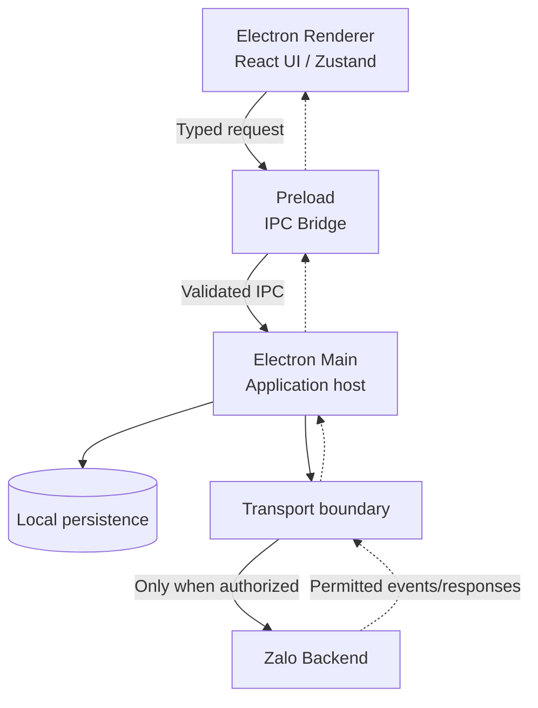
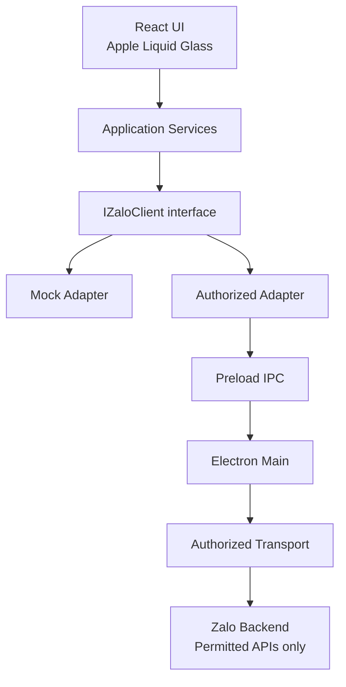

# ZALO APPLE GLASS — MASTER PLAN V2

> **Workspace:** `D:\Zalo`  
> **Platform:** Windows Desktop  
> **Stack:** Electron + React + TypeScript + Vite + Tailwind CSS v4 + Zustand + Motion  
> **Status:** Tiếp tục từ **R6**; giữ nguyên kết quả R1–R5 và không quay lại hướng CSS injection.  
> **Mục tiêu:** Xây dựng Zalo Desktop Client độc lập với giao diện Apple Liquid Glass, hướng đến sử dụng dịch vụ Zalo thật bằng các phương thức **được phép và có thể kiểm chứng**.

---

## 1. Product Vision — Mục tiêu cuối cùng

Xây dựng một **ứng dụng Zalo Desktop mới hoàn toàn**, không sửa đổi ứng dụng Zalo chính thức, với:

- **Giao diện:** Apple Liquid Glass tự xây dựng, hỗ trợ light/dark mode, animation, accessibility và tối ưu Windows.
- **Tài khoản:** Xác thực tài khoản thật qua phương thức được phép.
- **Messaging:** Hội thoại, gửi/nhận tin nhắn, trạng thái gửi và cập nhật realtime khi được hỗ trợ.
- **Contacts:** Danh bạ, hồ sơ liên hệ và tìm kiếm trong phạm vi API cho phép.
- **Media:** Gửi/nhận ảnh, video và tệp đính kèm khi có contract và quyền sử dụng.
- **Groups:** Chat nhóm và quản lý trạng thái nhóm nếu có quyền phù hợp.
- **Calling:** Gọi thoại/video nếu xác minh được contract, quyền sử dụng và khả năng tích hợp.
- **Sync:** Đồng bộ lịch sử, trạng thái và sự kiện với backend theo khả năng thực tế.
- **Notifications:** Thông báo desktop và badge.
- **Distribution:** Ứng dụng Windows có thể đóng gói, cài đặt và cập nhật.

**Đích đến là client thật, không phải bản mock.** Mock Adapter chỉ phục vụ phát triển UI và kiểm thử độc lập; không được báo cáo chức năng backend là PASS khi mới chạy mock.

### 1.1. Các ràng buộc bất biến

1. Giữ nguyên ứng dụng Zalo chính thức.
2. Dùng **REA** làm công cụ Reverse Engineering duy nhất.
3. Không sử dụng implementation của các Zalo client bên thứ ba.
4. Không sao chép bundle Zalo vào ứng dụng mới.
5. Không trích xuất, ghi log hoặc đưa vào báo cáo credential, cookie, session token, encryption secret hay dữ liệu cá nhân.
6. Không bypass authentication, server authorization hoặc các cơ chế bảo vệ.
7. API nội bộ quan sát được **không mặc nhiên** là API được phép sử dụng.
8. Chỉ thực hiện kết nối thật qua API/cơ chế đã xác minh quyền sử dụng.
9. Không sửa hoặc viết lại báo cáo R1–R5 nếu chưa có yêu cầu riêng.
10. Không báo PASS nếu chưa thực thi kiểm thử tương ứng và lưu bằng chứng.
11. **Không kết luận NO-GO cho toàn bộ custom client chỉ từ R5**: R5 nghiên cứu một kiến trúc khác.
12. Không tiếp tục nghiên cứu CSS injection, `app.asar` patch hay stylesheet injection.

### 1.2. Hai bài toán tách biệt

- **Technical understanding:** REA giúp hiểu kiến trúc, data flow, các module và contract có bằng chứng.
- **Authorized interoperability:** Chỉ nguồn tài liệu, quyền truy cập và kiểm thử được phép mới chứng minh một chức năng có thể dùng với Zalo thật.

Cần phân biệt API cho **tài khoản cá nhân** với API dành cho **Official Account** hoặc các phạm vi OAuth khác. Khả năng kỹ thuật quan sát được không tự động đồng nghĩa với quyền tích hợp.

---

## 2. Roadmap tổng thể

| Phase | Tên | Ưu tiên | Mục tiêu | Đầu ra chính |
|---|---|---|---|---|
| **R6** | Architecture & Backend Contract Research | **P0 — làm ngay** | Xác định kiến trúc và contract có chứng cứ từ REA | `reports/R6_CLIENT_ARCHITECTURE.md` |
| **R7** | Protocol & Feature Compatibility | **P0** | Đối chiếu tính năng, API và quyền sử dụng | `reports/R7_PROTOCOL_AND_FEATURE_MAP.md`, `docs/API_AUTHORIZATION_GAP.md` |
| **R8** | Independent Custom Client Architecture | **P0** | Thiết kế TypeScript interfaces, application services, mock adapter, IPC | `docs/CUSTOM_CLIENT_ARCHITECTURE.md`, `src/adapters/types.ts` |
| **R9** | Apple Liquid Glass Design System | P1 | Xây UI kit, tokens, desktop layouts và hiệu ứng | `docs/GLASS_DESIGN_SYSTEM.md`, components |
| **R10** | Mock Desktop Client | P1 | Hoàn thiện luồng sử dụng bằng mock, kiểm thử UI | Mock features, integration tests |
| **R11** | Authorized Backend Integration | **P0 cho mục tiêu sản phẩm** | Kết nối từng chức năng có quyền sử dụng đã được xác minh | Authorized adapters, live tests |
| **R12** | Verification, Packaging & Release | P1 | Kiểm thử, hardening và đóng gói Windows | Release build, test report |

**Thứ tự thực thi:** R6 → R7 → R8 → R9 → R10 → R11 → R12. R7 có thể khởi động kiểm tra tài liệu/API song song ở mức có kiểm soát, nhưng **không làm R9–R12 thay cho việc giải quyết R6–R8**.

---

## 3. R6 — Architecture & Backend Contract Research

### 3.1. Mục tiêu

Dựa trên bằng chứng REA hiện có trong `D:\Zalo`, làm rõ ranh giới **UI logic / business logic / local persistence / network transport**, tránh nhầm lẫn giữa luồng giao diện và quyền truy cập backend.

### 3.2. Phạm vi module

| Module | Cần nghiên cứu |
|---|---|
| Authentication | Login flow, trạng thái xác thực, session lifecycle, lỗi và đăng xuất ở mức không tiết lộ secret |
| Messaging | Conversation, message model, event, delivery state, pagination và luồng gửi/nhận |
| Contacts | Danh bạ, hồ sơ, tìm kiếm, state và cập nhật |
| Media | Metadata, luồng chọn file, upload/download, progress, error handling |
| Calling | UI call state, signaling flow, media session boundaries, permissions |
| Sync | Đồng bộ lịch sử/trạng thái, cursor, state reconciliation, retry |
| Notifications | Event listeners, unread count, OS notifications, badge |

### 3.3. Phương pháp

1. Kiểm kê báo cáo R1–R5 và nguồn bằng chứng REA hiện có, không tái chạy các phần đã có bằng chứng đầy đủ.
2. Lập **Evidence Index**: `evidence_id`, module, nguồn/vị trí, loại bằng chứng, nội dung đã làm sạch dữ liệu nhạy cảm, giới hạn kết luận.
3. Truy vết từng module từ entry point → UI/state → service → storage/transport.
4. Tách dữ liệu **OBSERVED** (đã quan sát), **INFERRED** (suy luận), **UNKNOWN** (thiếu bằng chứng).
5. Chỉ ghi protocol/contract ở mức chứng minh được bằng phân tích tĩnh; không giả lập hoặc tự gọi endpoint nội bộ.
6. Xây dựng data-flow diagram cho Renderer, Preload, Main, local storage và backend.
7. Ghi rõ *what is known / unknown / blocked* với từng luồng.

### 3.4. Sơ đồ tham chiếu để kiểm tra, không phải kết quả REA đã xác minh



> **Chú ý:** R6 có nhiệm vụ đối chiếu sơ đồ tham chiếu này với bằng chứng thực tế. Không coi sơ đồ đề xuất là sự thật về ứng dụng Zalo chính thức.

### 3.5. Đầu ra

`reports/R6_CLIENT_ARCHITECTURE.md`

Tài liệu phải có:

- Source Inventory & Evidence Index.
- Module Map cho cả 7 module.
- Dependency Map và boundary map.
- Data-flow diagram.
- Observed protocol/contract inventory.
- Danh sách giả định, suy luận và phần UNKNOWN.
- Những vấn đề tác động đến kiến trúc custom client.
- Evidence gaps và khuyến nghị cho R7.

### 3.6. Acceptance criteria

- [ ] Có bằng chứng hoặc nhãn UNKNOWN cho mọi module.
- [ ] Có tham chiếu nguồn cho mọi kết luận OBSERVED.
- [ ] Không chứa credential/token/cookie/PII.
- [ ] Không có lời khẳng định endpoint được phép chỉ dựa vào REA.
- [ ] Luồng Renderer/Preload/Main/Transport được phân biệt rõ.
- [ ] Có báo cáo các giới hạn phân tích và lệnh/test thực tế đã chạy.

---

## 4. R7 — Protocol & Feature Compatibility Matrix

### 4.1. Mục tiêu

Xác định khả năng thực hiện **từng tính năng trên dịch vụ Zalo thật**, đồng thời tách riêng **bằng chứng kỹ thuật**, **quyền sử dụng** và **kết quả kiểm thử**.

### 4.2. Ma trận cần hoàn thiện

| Feature | R6 evidence | API/contract | Authorized scope | Technical gap | Live test prerequisites | Status |
|---|---|---|---|---|---|---|
| Login | Cần điền | Cần xác minh | Cần xác minh | UNKNOWN | App registration, auth flow | UNKNOWN |
| Contacts | Cần điền | Cần xác minh | Cần xác minh | UNKNOWN | Approved scope, test data | UNKNOWN |
| Conversations | Cần điền | Cần xác minh | Cần xác minh | UNKNOWN | Account/data permission | UNKNOWN |
| Send/Receive Messages | Cần điền | Cần xác minh | Cần xác minh | UNKNOWN | Permitted send/read events | UNKNOWN |
| Send/Receive Files | Cần điền | Cần xác minh | Cần xác minh | UNKNOWN | Media permissions and limits | UNKNOWN |
| Groups | Cần điền | Cần xác minh | Cần xác minh | UNKNOWN | Group-specific permissions | UNKNOWN |
| Voice/Video Calls | Cần điền | Cần xác minh | Cần xác minh | UNKNOWN | Calling scope, mic/camera permissions | UNKNOWN |
| Sync | Cần điền | Cần xác minh | Cần xác minh | UNKNOWN | History/event capabilities | UNKNOWN |
| Notifications | Cần điền | Cần xác minh | Cần xác minh | UNKNOWN | Push/webhook/event permissions | UNKNOWN |

*Các ô trên là template công việc, **không phải** kết quả nghiên cứu hay tuyên bố một API đang tồn tại/được cấp quyền.*

### 4.3. Quy tắc thẩm định

- Ghi riêng contract **quan sát được qua REA** và API **được công bố/được cấp quyền**.
- Không áp dụng mặc định API của Official Account cho tài khoản người dùng cá nhân.
- Không mặc định OAuth login đồng nghĩa quyền đọc/gửi toàn bộ tin nhắn cá nhân.
- Ghi rõ nguồn tài liệu chính thức, phạm vi scope, phê duyệt/quyền thực tế và điều kiện môi trường thử nghiệm.
- `BLOCKED` là trạng thái của **tính năng hoặc phương án tích hợp**, không phải kết luận tự động cho toàn dự án.

### 4.4. Đầu ra

- `reports/R7_PROTOCOL_AND_FEATURE_MAP.md`
- `docs/API_AUTHORIZATION_GAP.md`

### 4.5. Acceptance criteria

- [ ] Cả 9 tính năng đều được điền thông tin, kể cả khi kết quả là UNKNOWN.
- [ ] Mỗi tính năng có evidence/contract/scope/gap/prerequisites/status.
- [ ] Có kết luận riêng cho personal account / OA hoặc phạm vi khác khi thích hợp.
- [ ] Các yêu cầu thử nghiệm thật phải có điều kiện quyền sử dụng cụ thể.
- [ ] Không báo LIVE_PASS nếu chưa có kiểm thử thật.

---

## 5. R8 — Independent Custom Client Architecture

### 5.1. Mục tiêu

Tạo core độc lập để UI hoạt động với mock và có thể chuyển qua adapter thật cho các chức năng được phép mà **không viết lại toàn bộ React UI**.

### 5.2. Kiến trúc mục tiêu



> Sơ đồ mô tả **kiến trúc custom client sẽ xây**, không phải claim về kiến trúc Zalo chính thức.

### 5.3. Nguyên tắc thiết kế

- Domain models và interface độc lập React/Electron.
- Dependency injection chọn `MockZaloClient` hoặc `AuthorizedZaloClient` theo cấu hình.
- Renderer không được đọc bí mật hoặc gọi Node.js trực tiếp.
- Preload cung cấp IPC được khai báo rõ, có kiểm tra dữ liệu tại boundary.
- Main Process quản lý native APIs, local persistence và network transport ở nơi thích hợp.
- Không triển khai network transport đến endpoint nội bộ khi chưa chứng minh quyền truy cập.
- Event streams cần typed payload, unsubscribe/cleanup, lỗi rõ ràng.
- Trạng thái capability phải phản ánh được tính năng nào đang ở mock, available, unsupported, blocked.

### 5.4. Hợp đồng TypeScript cần thiết kế

`src/adapters/types.ts` tối thiểu nên mô tả:

- `ZaloUser`, `Contact`, `Conversation`, `Message`, `Attachment`, `Group`, `CallSession`, `Notification`.
- `AuthCapabilities`, `MessagingCapabilities`, `MediaCapabilities`, `CallingCapabilities` hoặc cơ chế capability tương đương.
- Các cổng chức năng: `AuthPort`, `ContactsPort`, `ConversationsPort`, `MessagingPort`, `MediaPort`, `GroupsPort`, `CallingPort`, `SyncPort`, `NotificationsPort`.
- `IZaloClient` hợp nhất các cổng nghiệp vụ hoặc mô tả một tổ hợp các service.
- `Result<T, E>`, `Pagination`, `ClientError`, event subscription và abort/cancellation nơi cần.

Interface chi tiết phải xuất phát từ R6–R7; không giả định field hay backend contract chưa có bằng chứng.

### 5.5. Mock Adapter

Mock hỗ trợ fake login, conversations, contacts, message send/receive, attachment progress, call states, notifications, lỗi mô phỏng và reconnect/sync scenarios. Tất cả dữ liệu phải được tạo giả và không chứa dữ liệu thực của người dùng.

### 5.6. Đầu ra

- `docs/CUSTOM_CLIENT_ARCHITECTURE.md`
- `src/adapters/types.ts`
- Mock adapter và test liên quan (vị trí phụ thuộc cấu trúc source thực tế).

### 5.7. Acceptance criteria

- [ ] TypeScript compile thành công.
- [ ] Mock Adapter triển khai đúng contract.
- [ ] Test ít nhất một happy path và một failure path cho mỗi capability đã mock.
- [ ] Renderer không truy cập Node trực tiếp.
- [ ] IPC có typed contract và validation.
- [ ] Mock mode không phát request tới Zalo.

---

## 6. R9 — Apple Liquid Glass Design System

**Mục tiêu:** Xây dựng giao diện Apple Liquid Glass độc lập, không copy style/bundle của Zalo.

### Phạm vi

- Design tokens: palette, typography, spacing, radius, elevation, blur, motion.
- Glass surfaces: sidebar, navigation, titlebar, toolbar, dialogs, popovers, cards.
- Light/dark mode, reduced motion, keyboard navigation, focus states.
- Adaptive/performance fallback cho môi trường không hỗ trợ blur tốt.
- Desktop screens: chat list, chat detail, contacts, profile, group info, media viewer, call UI, notifications, settings.

### Đầu ra

- `docs/GLASS_DESIGN_SYSTEM.md`
- `src/design-system/`
- `src/components/glass/`

**Done khi:** Các UI component chính chạy trong Electron, kiểm thử visual/interaction cơ bản, không phụ thuộc backend thật.

---

## 7. R10 — Functional Mock Desktop Client

**Mục tiêu:** Hoàn thiện trải nghiệm sử dụng trên UI, sử dụng Mock Adapter để test workflow độc lập với backend.

### Workflow tối thiểu

1. Mở app, fake login, hiển thị danh sách hội thoại.
2. Mở chat, cuộn lịch sử, tải trang tiếp theo.
3. Gửi tin nhắn và mô phỏng pending/sent/failed/retry.
4. Mô phỏng nhận tin, unread badge và desktop notifications.
5. Danh bạ, nhóm, thông tin cuộc trò chuyện.
6. Chọn file và hiển thị trạng thái upload/download giả lập.
7. UI cuộc gọi thoại/video với mocked session state.
8. Mô phỏng mất mạng, đồng bộ và khôi phục.

**Done khi:** Workflow chạy được trên Electron và có automated tests cho các luồng quan trọng. Trạng thái là `MOCK_PASS`, **không** phải `LIVE_PASS`.

---

## 8. R11 — Authorized Backend Integration

**Mục tiêu:** Kết nối thật từng capability **đã xác minh có quyền sử dụng**.

### Quy trình bắt buộc trước mỗi chức năng

1. Xác định API chính thức/cơ chế tích hợp được phép.
2. Xác minh scope, điều kiện đăng ký ứng dụng, tài khoản kiểm thử và quyền được cấp.
3. Định nghĩa contract test dựa trên tài liệu có thể dẫn nguồn.
4. Tạo `Authorized Adapter` tương ứng, qua transport boundary an toàn.
5. Chạy integration test trên môi trường/đối tượng được phép.
6. Ghi lại kết quả đã làm sạch secret/PII; chỉ khi đó mới dùng `LIVE_PASS`.

### Thứ tự tích hợp gợi ý

- Xác thực được phép → thông tin tài khoản trong scope → một luồng gửi/nhận được phép → media/events → các khả năng còn lại.
- Ưu tiên kiểm chứng **một vertical slice từ UI đến backend** trước khi mở rộng.
- Nếu chỉ API Official Account phù hợp, ghi rõ đó là chức năng OA; không gọi là chat cá nhân.
- Nếu chưa có API/quyền phù hợp, giữ tính năng `BLOCKED` và phát triển UI độc lập; không thay bằng endpoint nội bộ.

### Exit criteria

- Mỗi chức năng đang bật ở chế độ live có bằng chứng quyền sử dụng và test thực tế.
- Thất bại mạng, hết hạn quyền/phiên, retry và logs được xử lý an toàn.
- Capability chưa được phép hiển thị trung thực là chưa hỗ trợ.

---

## 9. R12 — Verification, Security & Windows Release

**Mục tiêu:** Sẵn sàng phát hành trong phạm vi tính năng đã chứng minh được.

### Checklist

- [ ] Unit tests, renderer integration tests, Electron IPC tests.
- [ ] Live E2E tests cho đúng các API đã được cấp quyền.
- [ ] Electron security: context isolation, sandbox phù hợp, CSP, navigation/permission policies.
- [ ] Không lưu secret dưới dạng plaintext, không log PII hoặc token.
- [ ] Kiểm thử network failures, state recovery, startup/shutdown.
- [ ] Permission mic/camera khi có calling.
- [ ] Kiểm thử hiệu năng Glass UI và reduced-motion fallback.
- [ ] Windows packaging, installer, versioning, release notes.
- [ ] Tài liệu nêu chính xác phạm vi tính năng thật so với mock/blocked.

---

## 10. Evidence, Authorization & Test Status

Không sử dụng một cột PASS chung cho mọi trường hợp. Mỗi feature cần tối thiểu ba chiều trạng thái:

| Dimension | Values | Ý nghĩa |
|---|---|---|
| Evidence | `OBSERVED`, `INFERRED`, `UNKNOWN` | Mức chắc chắn về kiến trúc/contract |
| Authorization | `AUTHORIZED`, `UNKNOWN`, `BLOCKED` | Trạng thái quyền tích hợp |
| Testing | `NOT_TESTED`, `MOCK_PASS`, `MOCK_FAIL`, `LIVE_PASS`, `LIVE_FAIL` | Kết quả chạy test thực tế |

**Quy tắc:** `OBSERVED ≠ AUTHORIZED ≠ LIVE_PASS`, và `MOCK_PASS ≠ LIVE_PASS`.

### Quyết định sau R7

| Kết quả | Hướng đi |
|---|---|
| API và quyền truy cập hỗ trợ personal-client features | Tích hợp đầy đủ trong đúng phạm vi được cấp quyền |
| Chỉ một phần features được hỗ trợ | Implement theo capability, hiển thị phần unavailable |
| Chỉ OA/Social APIs phù hợp | Có thể triển khai scope OA/Social; chưa hoàn thành mục tiêu thay thế client cá nhân |
| Chưa có quyền truy cập phù hợp | Tiếp tục architecture/UI mock, làm rõ authorization gap; không gọi endpoint nội bộ |

Không kết luận cả custom client `NO-GO` chỉ do kết quả R5 hoặc một tính năng bị `BLOCKED`.

---

## 11. Cấu trúc thư mục mục tiêu

> Đây là **cấu trúc đề xuất**. Agent phải kiểm tra cây thư mục hiện có trước khi tạo hoặc di chuyển file.

```text
D:\Zalo\
├── reports/
│   ├── R1 ... R5 (giữ nguyên)
│   ├── R6_CLIENT_ARCHITECTURE.md
│   └── R7_PROTOCOL_AND_FEATURE_MAP.md
├── docs/
│   ├── CUSTOM_CLIENT_ARCHITECTURE.md
│   ├── API_AUTHORIZATION_GAP.md
│   └── GLASS_DESIGN_SYSTEM.md
├── electron/
│   ├── main/
│   └── preload/
├── src/
│   ├── adapters/
│   │   ├── types.ts
│   │   ├── mock/
│   │   └── authorized/
│   ├── application/
│   ├── components/glass/
│   ├── features/
│   ├── stores/
│   └── design-system/
├── tests/
└── package.json
```

---

## 12. Prompt thực thi — Dán cho OpenCode hoặc Claude Code

```text
TASK: ZALO APPLE GLASS — R6 FIRST / MASTER PLAN V2

Workspace: D:\Zalo

FINAL OBJECTIVE
Build a fully independent Electron-based Zalo Desktop Client with an original
Apple Liquid Glass UI, aiming to use real Zalo services only through verified
and authorized integration methods.

The goal is NOT a CSS theme, app.asar patch, stylesheet injection, or a wrapper
around the official app. Mock mode is a development tool, NOT the final product.

TECH STACK
Electron + React + TypeScript + Vite + Tailwind CSS v4 + Zustand + Motion.

MANDATORY CONSTRAINTS
1. Preserve the official Zalo application unchanged.
2. Use REA as the only reverse-engineering tool.
3. Do not use third-party Zalo client implementations.
4. Do not copy Zalo application bundles into this project.
5. Never extract or log credentials, cookies, session tokens, encryption secrets,
   or personal data.
6. Never bypass authentication, authorization, or security controls.
7. Observed internal APIs are not automatically authorized public APIs.
8. Do not make unauthorized backend calls.
9. Preserve R1–R5 research reports and prior validated work.
10. No PASS without executed tests and supporting evidence.
11. Do not conclude that custom-client architecture is NO-GO solely from R5.
12. Stop all CSS injection, app.asar patching and stylesheet injection research.

CURRENT PRIORITY: R6
- Inventory the existing D:\Zalo workspace, reports and REA artifacts.
- Examine Authentication, Messaging, Contacts, Media, Calling, Sync and Notifications.
- Separate UI logic, business logic, local persistence and network transport.
- Trace relevant data flow, state transitions and evidenced contracts.
- Document Renderer / Preload / Main / backend boundaries.
- Classify findings OBSERVED, INFERRED or UNKNOWN.
- Attach sanitized evidence references, not secret values.
- Write reports/R6_CLIENT_ARCHITECTURE.md.
- Do not invent conclusions when REA evidence is unavailable.

NEXT: R7
For login, contacts, conversations, messages, files, groups, calls,
synchronization and notifications:
- Map module and data flow.
- Record evidenced contract.
- Separately verify authorized API scope and practical availability.
- Distinguish personal-account and Official Account capabilities.
- Record authorization gaps, UNKNOWN/BLOCKED areas and live test prerequisites.
- Write reports/R7_PROTOCOL_AND_FEATURE_MAP.md.
- Write docs/API_AUTHORIZATION_GAP.md.

NEXT: R8
Design:
React UI -> Application Services -> IZaloClient -> Adapter ->
Authorized Transport -> Zalo Backend.

- Implement strongly typed TypeScript interfaces and domain models.
- Implement Mock Adapter for offline UI development.
- Plan authorized adapter only for verified, permitted capabilities.
- Use secure typed IPC between Renderer / Preload / Main.
- Renderer has no direct Node.js access and no secrets.
- Write docs/CUSTOM_CLIENT_ARCHITECTURE.md.
- Write src/adapters/types.ts.
- Add tests where appropriate; never claim tests ran if they did not.

FUTURE WORK
R9: Apple Liquid Glass Design System.
R10: Fully functional mock desktop client.
R11: Authorized real backend integration by feature.
R12: Verification, security hardening and Windows packaging.

REPORT FORMAT
- Files inspected.
- Evidence references.
- Observed findings.
- Inferred findings.
- Unknowns and authorization gaps.
- Files created/modified.
- Commands/tests actually run and their outcomes.
- Blockers and next recommended action.

START NOW WITH R6 ONLY. Do not continue CSS injection research.
```

---

## 13. Hành động tiếp theo

**Bắt đầu R6 ngay.** Sau khi nhận `reports/R6_CLIENT_ARCHITECTURE.md`, kiểm tra tính đầy đủ của evidence và các nhãn OBSERVED/INFERRED/UNKNOWN. Sau đó chuyển R7 để đánh giá chính xác khả năng tích hợp Zalo thật, rồi mới khóa interface R8 và mở rộng UI.

**Nguyên tắc xuyên suốt:** Giữ mục tiêu **Zalo Desktop Client thật với Apple Liquid Glass**, nhưng không đánh đồng khả năng reverse engineer với quyền sử dụng backend.
